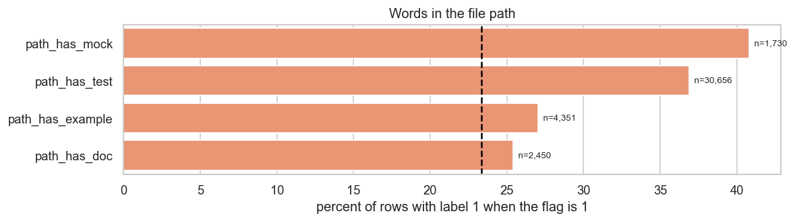
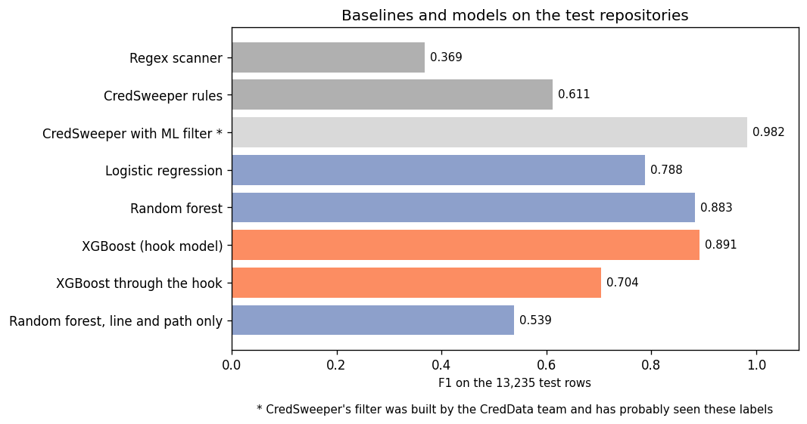

# GITSHEILD

Telling real leaked credentials apart from false alarms in source code.

## Problem statement

Secret scanners find passwords, API keys and tokens in code by matching keywords and patterns. Most of what they flag is not a real secret: placeholders, test values, example strings or random text that only looks like a key. Too many false alarms make developers ignore the scanner. This project uses the context around each candidate (the variable name, the file type, the path and the shape of the value) to predict whether a flagged line holds a real credential.

Phase 1 covers cleaning, exploratory data analysis and preprocessing. Phase 2 trains and explains a model.

## Dataset

The data is [Samsung CredData](https://github.com/Samsung/CredData), a benchmark of lines from open source repositories that annotators labeled by hand.

- Each label points at a file, a line and optionally a value in that line.
- GroundTruth is T for a real looking credential, F for a false positive and X for a test value, example or placeholder. Our target `label` is 1 for T and 0 for F or X.
- The secret values were replaced with random look alikes, so only context is meaningful.
- The CredData README describes 297 repositories and 73,842 labeled lines with about 6 percent real credentials. The version we downloaded differs: 337 repositories and 67,896 labeled lines with 23.2 percent T. We report our own measured numbers.

The data is not stored in this repository, because GitHub push protection rejects the look alike secrets. `src/extract_lines.py` builds `data/raw/credata_raw_extract.csv` from a CredData download, and `notebooks/01_cleaning.ipynb` builds `data/processed/credata_clean.csv` from it.

## Cleaning summary

Done in `notebooks/01_cleaning.ipynb`, with every choice recorded in `docs/DECISIONS.md`.

| Step | Rows removed | Rows left |
| --- | --- | --- |
| Raw extract | 0 | 67,896 |
| Drop rows that use a FileID shared by several repositories | 1,602 | 66,294 |
| Drop rows whose value ends past the end of the line | 3 | 66,291 |

- 78 FileID values appear in more than one repository, and the first extraction read some of their labels from the wrong copy. All 557 rows whose line was not found are among the 1,602 dropped rows.
- Empty cells are kept, because each has a meaning, such as a whole line marked or a file without an extension.
- No rows are dropped as duplicates. There are no exact duplicates, and repeated lines are separate labels.
- Outliers are kept. Very long lines are real code such as bundled files, and long values are mostly real secrets. Lengths are log transformed in preprocessing instead.
- Domain spelling Github is changed to GitHub on 38 rows.

The cleaned file has 66,291 rows in 335 repositories, with 15,470 real credentials (23.34 percent). The 1,602 rows with shared FileID values stay dropped for both phases.

## Preprocessing summary

Done in `notebooks/03_preprocessing.ipynb`.

- Rows are split by repository so no repository is in both sets. GroupShuffleSplit with seed 65 gives train 268 repositories and 53,056 rows (label 1 23.36 percent) and test 67 repositories and 13,235 rows (label 1 23.26 percent). The test set has twice the share of X labels (10.36 against 4.76 percent).
- 148 test rows (1.12 percent) share their line text with train. All have label 0, so they are kept.
- log1p is applied to value_len, line_len, line_number, lines_spanned and var_name_len to cut their skew.
- The 11 numeric features are scaled with a StandardScaler fitted on train only. The 28 flags stay 0 and 1.
- The outputs are features_train.csv, features_test.csv, repo_split.csv and scaler_params.csv in data/processed, kept out of git.

## Features

`src/features.py` turns each row into 39 numeric columns, each worked out from its own row so nothing is fitted on the whole data.

- Value: length, entropy, whether it is empty, and the share of digits, upper case, lower case and symbols.
- Line: length, line number, lines spanned, and flags for an assignment, quotes, a URL, a comment and a private key header.
- Variable name: its length, and whether it or the whole line contains password, secret, token, key or auth.
- Path: whether it contains test, example, mock or doc words, its depth, and the file type group (code, config, script, doc, key file, none or other).

Labels, ids, Category, CryptographyKey and PredefinedPattern are left out, because they are annotator notes a scanner would not have.

## Key findings

From `notebooks/02_eda.ipynb`. The full write up is in `INSIGHTS.md` and the charts are in `images`.

1. Real credentials are 23.34 percent of rows, so the classes are imbalanced.
2. The shape of the value is the strongest signal. Real values are longer (median 36 against 18 characters), more random (entropy 3.74 against 3.24) and richer in digits.
3. 62.5 percent of not real rows have no value, against 9.0 percent of real rows. This likely reflects how false positives were labeled, so Phase 2 must check that the model does not lean on it.
4. Keywords such as password and token are not more common in real secrets, because every candidate was found by keyword. A private key header (93.2 percent real) and secret in the variable name (43.8 percent) are the exceptions.
5. Test and mock folders hold more real secrets than average (36.9 and 40.8 percent), so skipping them would miss credentials.
6. Doc and text files (43.6 percent real) hold real secrets far more often than source code (15.3 percent).
7. F and X differ. X values are short and low in entropy, but X often sits in test paths and is named like a password, as T is. The test set has twice the share of X, so Phase 2 should report results by GroundTruth.




## Phase 2: models, baselines and the hook

### Models

Done in `notebooks/04_models.ipynb`. Three models are trained with class weights on the train repositories: logistic regression, random forest and XGBoost. Each is tuned with 5 fold cross validation grouped by repository, on three feature sets: all 39 features, all but `value_empty`, and line and path features only. Each model's decision threshold is the one with the best F1 on its out of fold predictions, so the test set was used only once, at the end.

The hook model is **XGBoost without `value_empty`** (max_depth 6, learning_rate 0.1, 300 trees, threshold 0.4158). It was chosen by a rule fixed before any test score, and it also has the highest test F1. `value_empty` is left out because the hook cannot rebuild it, and the trees never used it anyway: XGBoost with and without it scores the same.

### Results on the test repositories

All scores are on the 13,235 test rows from 67 repositories that were never used in training. The models come from `04_models.ipynb`, the baselines and the hook row from `06_baselines.ipynb`.

| Scanner | Precision | Recall | F1 |
| --- | --- | --- | --- |
| Flag every line | 0.2326 | 1.0000 | 0.3774 |
| Regex scanner (keyword next to an assignment, or a known key format) | 0.2651 | 0.6049 | 0.3686 |
| CredSweeper 1.19.6, rules only | 0.4414 | 0.9932 | 0.6112 |
| CredSweeper 1.19.6 with its ML filter * | 0.9787 | 0.9860 | 0.9824 |
| Logistic regression, without value_empty | 0.7930 | 0.7830 | 0.7880 |
| Random forest, without value_empty | 0.8944 | 0.8723 | 0.8832 |
| **XGBoost, without value_empty (hook model)** | **0.8565** | **0.9288** | **0.8912** |
| **XGBoost through the hook (value found by the hook's rule)** | **0.6929** | **0.7147** | **0.7037** |
| Random forest, line and path features only | 0.3785 | 0.9344 | 0.5387 |

\* CredSweeper comes from the team that built CredData. Its filter flags only 0.7 percent of F rows and 0.4 percent of X rows, so it has very likely been trained on these labels, and its score is not a fair comparison.



- The hook model finds 2,859 of 3,078 real secrets (92.88 percent) and raises false alarms on 3.31 percent of F rows and 13.71 percent of X rows. Its test average precision is 0.9468 and ROC AUC 0.9859.
- Its average precision in cross validation is lower, 0.9072 with a standard deviation of 0.0325, because scores vary a lot by repository. The cross validation number is the more careful estimate.
- Without the 148 test rows whose line text also appears in train, F1 changes by at most 0.0028 for any model (0.8915 for the hook model).
- **Through the hook, F1 drops from 0.8912 to 0.7037.** The hook cannot see the annotated value, so it finds the value with a simple rule. The rule finds exactly the annotated value on 49.93 percent of the 6,104 single line test rows that have one, and on 24.68 percent of all 13,086 single line test rows. The model then misses 677 more real secrets, mostly in config (307) and code (280) files, and raises 578 more false alarms on F rows. It is still well above the regex scanner and CredSweeper's rules.
- The line and path models need no value but flag over 40 percent of F rows, so they are not usable on their own.

### What the model relies on

From `notebooks/05_explain.ipynb` with SHAP on all test rows. The value features dominate: `value_entropy` alone holds 29.88 percent of the total SHAP importance, and the five largest features hold 60.35 percent, four of them describing the value. The full write up is in `INSIGHTS.md`.

## The pre-commit hook

`src/hook.py` scans the lines added in a commit and blocks the commit when one of them looks like a real secret. It builds the same 38 features as training with `src/features.py`, applies the saved log transform and scaling from `data/processed/scaler_params.csv`, and scores each line with `models/gitguard_model.joblib`.

To match training, it

- finds the value as the text after the first `:=`, `=>`, `=` or `:`, trimmed, without a trailing comma or semicolon and cut at the matching quote
- rewrites the file path to the CredData shape, `data/00000000/folders/00000000.ext`, because training paths keep their folders but use random file names
- joins a private key from its BEGIN line to its END line into one row, as the labels do
- skips lockfiles, notebook image lines and any line that contains the comment `gitsheild:allow`

### Install

The hook needs the model file `models/gitguard_model.joblib` and `data/processed/scaler_params.csv`, which stay out of git and are shared by the team. Then, inside the repository you want to protect:

```bash
python path/to/GITSHEILD/src/hook.py --install
```

This writes `.git/hooks/pre-commit`, which runs the hook with the same Python on every commit.

### Use

```text
$ git commit -m "add settings"
GITSHEILD: 1 added line(s) look like real secrets (xgboost_no_value_empty, threshold 0.4158)
  settings.py:1  score 1.00  Xk9p************
Remove the secret, add the comment gitsheild:allow to the line, or commit with --no-verify if you are sure it is not one.
```

The value is masked in the output. A commit of normal code goes through without any message. To test lines without committing:

```bash
python src/hook.py --scan some_file.py
```

## Repository layout

| Path | Contents | Owner |
| --- | --- | --- |
| `src/extract_lines.py` | Builds the raw extract from a CredData download | A |
| `notebooks/01_cleaning.ipynb` | Cleaning and the cleaned file | A |
| `src/features.py` | `load_data` and `build_features` | B |
| `notebooks/02_eda.ipynb` | Exploratory data analysis | B |
| `notebooks/03_preprocessing.ipynb` | Split by repository, log transform and scaling fitted on train | A |
| `notebooks/04_models.ipynb` | Grouped cross validation, three models, thresholds, saved models and test scores | A |
| `notebooks/05_explain.ipynb` | SHAP and error analysis | A |
| `notebooks/06_baselines.ipynb` | Regex and CredSweeper baselines, the comparison table and the hook on the test lines | B |
| `src/hook.py` | The pre-commit hook | B |
| `images` | Charts from 02_eda and 06_baselines, with notes in `images/NOTES.md` | B |
| `INSIGHTS.md` | Written findings | B |
| `docs` | Facts, decisions, progress, the cleaned data format and the Phase 2 plan | Both |

## How to run

1. Clone the repository and create an environment.

```bash
git clone https://github.com/Aneezakiran07/GITSHEILD.git
cd GITSHEILD
python -m venv .venv
.venv\Scripts\activate
pip install -r requirements.txt
```

On Linux or macOS, activate with `source .venv/bin/activate`.

2. Get the data. Either ask the team for `credata_raw_extract.csv` and put it in `data/raw`, or download CredData on Linux with its `download_data.py` (some file names are invalid on Windows) and run:

```bash
python src/extract_lines.py --root path/to/CredData --out data/raw/credata_raw_extract.csv
```

3. Run the notebooks in order from the `notebooks` folder: `01_cleaning.ipynb` writes `data/processed/credata_clean.csv`, `02_eda.ipynb` writes the charts to `images`, and `03_preprocessing.ipynb` prepares the model input.

```bash
cd notebooks
jupyter nbconvert --to notebook --execute --inplace 01_cleaning.ipynb
jupyter nbconvert --to notebook --execute --inplace 02_eda.ipynb
jupyter nbconvert --to notebook --execute --inplace 03_preprocessing.ipynb
```

4. Run the Phase 2 notebooks in order. `04_models.ipynb` saves the models to `models` and the test scores to `data/processed`, `05_explain.ipynb` explains the hook model, and `06_baselines.ipynb` scores the baselines and the hook. `06_baselines` runs CredSweeper on every test line, which takes several minutes.

```bash
jupyter nbconvert --to notebook --execute --inplace 04_models.ipynb
jupyter nbconvert --to notebook --execute --inplace 05_explain.ipynb
jupyter nbconvert --to notebook --execute --inplace 06_baselines.ipynb
```

## Team

- Person A: Aneeza Kiran, cleaning, preprocessing, models and explanation
- Person B: Fatima Kashif, features, EDA, baselines, the pre-commit hook and write up
