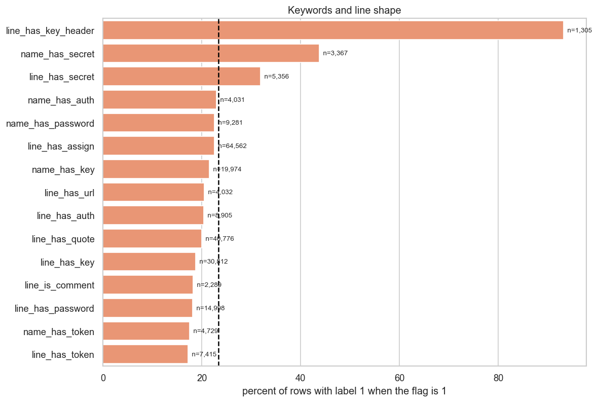
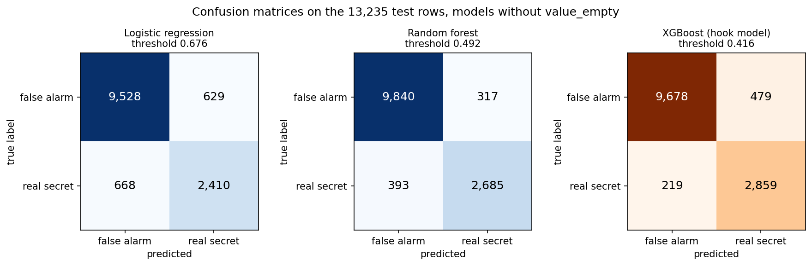
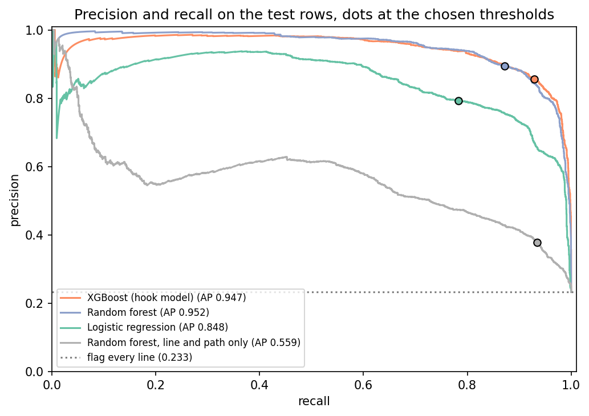
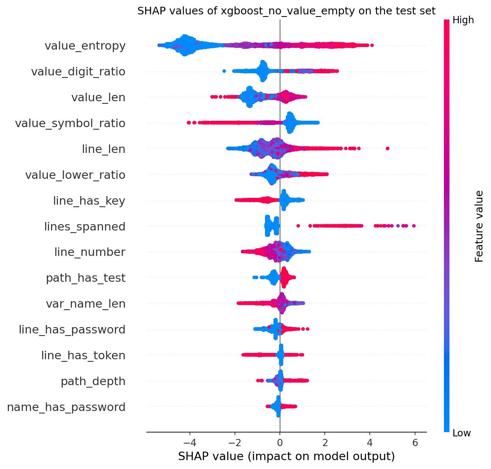
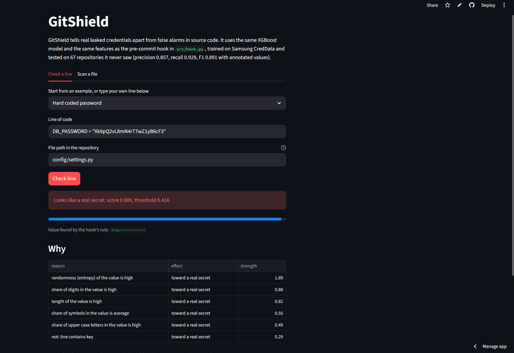

# GITSHEILD

Telling real leaked credentials apart from false alarms in source code.

**Live website: https://gitsheild.streamlit.app/**

## Problem statement

Secret scanners find passwords, API keys and tokens in code by matching keywords and patterns. Most of what they flag is not a real secret: placeholders, test values, example strings or random text that only looks like a key. Too many false alarms make developers ignore the scanner. This project uses the context around each candidate (the variable name, the file type, the path and the shape of the value) to predict whether a flagged line holds a real credential.

Phase 1 covers cleaning, exploratory data analysis and preprocessing. Phase 2 trains, evaluates and explains the models, compares them with existing scanners, and ships the best one as a pre-commit hook and as a [website](#website) where anyone can check a line of code or a whole file.

## Dataset

The data is [Samsung CredData](https://github.com/Samsung/CredData), a benchmark of lines from open source repositories that annotators labeled by hand.

- Each label points at a file, a line and optionally a value in that line.
- GroundTruth is T for a real looking credential, F for a false positive and X for a test value, example or placeholder. Our target `label` is 1 for T and 0 for F or X.
- The secret values were replaced with random look alikes, so only context is meaningful.
- The CredData README describes 297 repositories and 73,842 labeled lines with about 6 percent real credentials. The version we downloaded differs: 337 repositories and 67,896 labeled lines with 23.2 percent T. We report our own measured numbers.

The data is not stored in this repository, because GitHub push protection rejects the look alike secrets. `src/extract_lines.py` builds `data/raw/credata_raw_extract.csv` from a CredData download, and `notebooks/01_cleaning.ipynb` builds `data/processed/credata_clean.csv` from it.

## Cleaning summary

Done in `notebooks/01_cleaning.ipynb`, with every choice recorded in `docs/DECISIONS.md`.

| Step | Rows removed | Rows left |
| --- | --- | --- |
| Raw extract | 0 | 67,896 |
| Drop rows that use a FileID shared by several repositories | 1,602 | 66,294 |
| Drop rows whose value ends past the end of the line | 3 | 66,291 |

- 78 FileID values appear in more than one repository, and the first extraction read some of their labels from the wrong copy. All 557 rows whose line was not found are among the 1,602 dropped rows.
- Empty cells are kept, because each has a meaning, such as a whole line marked or a file without an extension.
- No rows are dropped as duplicates. There are no exact duplicates, and repeated lines are separate labels.
- Outliers are kept. Very long lines are real code such as bundled files, and long values are mostly real secrets. Lengths are log transformed in preprocessing instead.
- Domain spelling Github is changed to GitHub on 38 rows.

The cleaned file has 66,291 rows in 335 repositories, with 15,470 real credentials (23.34 percent). The 1,602 rows with shared FileID values stay dropped for both phases.

## Preprocessing summary

Done in `notebooks/03_preprocessing.ipynb`.

- Rows are split by repository so no repository is in both sets. GroupShuffleSplit with seed 65 gives train 268 repositories and 53,056 rows (label 1 23.36 percent) and test 67 repositories and 13,235 rows (label 1 23.26 percent). The test set has twice the share of X labels (10.36 against 4.76 percent).
- 148 test rows (1.12 percent) share their line text with train. All have label 0, so they are kept.
- log1p is applied to value_len, line_len, line_number, lines_spanned and var_name_len to cut their skew.
- The 11 numeric features are scaled with a StandardScaler fitted on train only. The 28 flags stay 0 and 1.
- The outputs are features_train.csv, features_test.csv, repo_split.csv and scaler_params.csv in data/processed, kept out of git.

## Features

`src/features.py` turns each row into 39 numeric columns, each worked out from its own row so nothing is fitted on the whole data.

- Value: length, entropy, whether it is empty, and the share of digits, upper case, lower case and symbols.
- Line: length, line number, lines spanned, and flags for an assignment, quotes, a URL, a comment and a private key header.
- Variable name: its length, and whether it or the whole line contains password, secret, token, key or auth.
- Path: whether it contains test, example, mock or doc words, its depth, and the file type group (code, config, script, doc, key file, none or other).

Labels, ids, Category, CryptographyKey and PredefinedPattern are left out, because they are annotator notes a scanner would not have.

## Key findings

From `notebooks/02_eda.ipynb`. The full write up is in `INSIGHTS.md` and the charts are in `images`.

1. Real credentials are 23.34 percent of rows, so the classes are imbalanced.
2. The shape of the value is the strongest signal. Real values are longer (median 36 against 18 characters), more random (entropy 3.74 against 3.24) and richer in digits.
3. 62.5 percent of not real rows have no value, against 9.0 percent of real rows. This likely reflects how false positives were labeled, so Phase 2 must check that the model does not lean on it.
4. Keywords such as password and token are not more common in real secrets, because every candidate was found by keyword. A private key header (93.2 percent real) and secret in the variable name (43.8 percent) are the exceptions.
5. Test and mock folders hold more real secrets than average (36.9 and 40.8 percent), so skipping them would miss credentials.
6. Doc and text files (43.6 percent real) hold real secrets far more often than source code (15.3 percent).
7. F and X differ. X values are short and low in entropy, but X often sits in test paths and is named like a password, as T is. The test set has twice the share of X, so Phase 2 should report results by GroundTruth.




## Phase 2: models, baselines and the hook

### Models

Done in `notebooks/04_models.ipynb`. Three models are trained with class weights on the train repositories: logistic regression, random forest and XGBoost. Each is tuned with 5 fold cross validation grouped by repository, on three feature sets: all 39 features, all but `value_empty`, and line and path features only. Each model's decision threshold is the one with the best F1 on its out of fold predictions, so the test set was used only once, at the end.

The hook model is **XGBoost without `value_empty`** (max_depth 6, learning_rate 0.1, 300 trees, threshold 0.4158). It was chosen by a rule fixed before any test score, and it also has the highest test F1. `value_empty` is left out because the hook cannot rebuild it, and the trees never used it anyway: XGBoost with and without it scores the same.

### Results on the test repositories

All scores are on the 13,235 test rows from 67 repositories that were never used in training. The models come from `04_models.ipynb`, the baselines and the hook row from `06_baselines.ipynb`.

| Scanner | Precision | Recall | F1 |
| --- | --- | --- | --- |
| Flag every line | 0.2326 | 1.0000 | 0.3774 |
| Regex scanner (keyword next to an assignment, or a known key format) | 0.2651 | 0.6049 | 0.3686 |
| CredSweeper 1.19.6, rules only | 0.4414 | 0.9932 | 0.6112 |
| CredSweeper 1.19.6 with its ML filter * | 0.9787 | 0.9860 | 0.9824 |
| Logistic regression, without value_empty | 0.7930 | 0.7830 | 0.7880 |
| Random forest, without value_empty | 0.8944 | 0.8723 | 0.8832 |
| **XGBoost, without value_empty (hook model)** | **0.8565** | **0.9288** | **0.8912** |
| **XGBoost through the hook (value found by the hook's rule)** | **0.6929** | **0.7147** | **0.7037** |
| Random forest, line and path features only | 0.3785 | 0.9344 | 0.5387 |

\* CredSweeper comes from the team that built CredData. Its filter flags only 0.7 percent of F rows and 0.4 percent of X rows, so it has very likely been trained on these labels, and its score is not a fair comparison.


- The hook model finds 2,859 of 3,078 real secrets (92.88 percent) and raises false alarms on 3.31 percent of F rows and 13.71 percent of X rows. Its test average precision is 0.9468 and ROC AUC 0.9859.
- Its average precision in cross validation is lower, 0.9072 with a standard deviation of 0.0325, because scores vary a lot by repository. The cross validation number is the more careful estimate.
- Without the 148 test rows whose line text also appears in train, F1 changes by at most 0.0028 for any model (0.8915 for the hook model).
- **Through the hook, F1 drops from 0.8912 to 0.7037.** The hook cannot see the annotated value, so it finds the value with a simple rule. The rule finds exactly the annotated value on 49.93 percent of the 6,104 single line test rows that have one, and on 24.68 percent of all 13,086 single line test rows. The model then misses 677 more real secrets, mostly in config (307) and code (280) files, and raises 578 more false alarms on F rows. It is still well above the regex scanner and CredSweeper's rules.
- The line and path models need no value but flag over 40 percent of F rows, so they are not usable on their own.

The confusion matrices show the trade between the two best models. The hook model misses 219 real secrets and raises 479 false alarms, while the random forest misses 393 and raises 317. A missed secret ends up in the repository history, so the model that misses fewer is the better scanner.



The precision recall curves of XGBoost and the random forest almost overlap, and XGBoost stays slightly higher at the high recall end where the hook works. The dots mark the thresholds chosen from the cross validation scores.



### What the model relies on and where it fails

From `notebooks/05_explain.ipynb` with SHAP on all test rows. The value features dominate: `value_entropy` alone holds 29.88 percent of the total SHAP importance, and the five largest features hold 60.35 percent, four of them describing the value. More entropy, digits and length push toward a real secret, more symbols push away, and a test path pushes toward a real secret because test folders hold many real secrets in CredData.



- **False alarms on X rows look like test passwords.** They have short values (median 8 characters), have password in the variable name 64.36 percent of the time against 20.32 percent for real secrets, and are pushed over the threshold mostly by values made of lower case letters.
- **Test paths raise false alarms but not misses.** The false alarm rate is 6.74 percent in test paths against 2.49 percent in paths without test, example, mock or doc words, while recall stays between 0.919 and 0.945 in every path group.
- **Errors are concentrated in a few repositories.** The 219 missed secrets come from 28 of the 67 test repositories, and one repository alone holds 74 of them.
- **The model and the rule scanners complement each other.** CredSweeper's rules find 218 of the model's 219 missed secrets, and no real secret in the test set is missed by the model, the regex scanner and the rules together, while the model avoids 3,631 of the rules' 3,869 false alarms.

The full write up is in `INSIGHTS.md`.

## The pre-commit hook

`src/hook.py` scans the lines added in a commit and blocks the commit when one of them looks like a real secret. It builds the same 38 features as training with `src/features.py`, applies the saved log transform and scaling from `models/scaler_params.csv`, and scores each line with `models/gitguard_model.joblib`.

To match training, it

- finds the value as the text after the first `:=`, `=>`, `=` or `:`, trimmed, without a trailing comma or semicolon and cut at the matching quote
- rewrites the file path to the CredData shape, `data/00000000/folders/00000000.ext`, because training paths keep their folders but use random file names
- joins a private key from its BEGIN line to its END line into one row, as the labels do
- skips lockfiles, notebook image lines and any line that contains the comment `gitsheild:allow`

### Install

The hook needs the model file `models/gitguard_model.joblib` and the scaler `models/scaler_params.csv`. Both are in the repository (the model is about 1 MB), so no data is needed. Install the packages from `requirements.txt`, then, inside the repository you want to protect:

```bash
python path/to/GITSHEILD/src/hook.py --install
```

This writes `.git/hooks/pre-commit`, which runs the hook with the same Python on every commit.

### Use

```text
$ git commit -m "add settings"
GITSHEILD: 1 added line(s) look like real secrets (xgboost_no_value_empty, threshold 0.4158)
  settings.py:1  score 1.00  Xk9p************
Remove the secret, add the comment gitsheild:allow to the line, or commit with --no-verify if you are sure it is not one.
```

The value is masked in the output. A commit of normal code goes through without any message. To test lines without committing:

```bash
python src/hook.py --scan some_file.py
```

## Website

`app/app.py` is a Streamlit website built on the same model and the same code as the hook, so it gives exactly the hook's scores.

- **Check a line:** paste a line of code and its file path, or pick one of the examples. The site shows the score, the threshold, whether the line looks like a real secret, and the six features that pushed the score most, from SHAP.
- **Scan a file:** upload a source or config file. The site scores every line, joins private key blocks as the hook does, and lists the lines that look like real secrets with their values masked.

**Live website: https://gitsheild.streamlit.app/** (deployed on Streamlit Community Cloud from `main`)



The screenshot shows the "Hard coded password" example: the line is flagged with a score of 0.989 against the threshold of 0.416, the value is masked, and the table lists the features that pushed the score, led by the high entropy of the value.

You can also run it locally from the repository root:

```bash
pip install -r app/requirements.txt
streamlit run app/app.py
```

Then open http://localhost:8501. The model and scaler files ship with the repository, so the website runs without the dataset or the notebooks.

## Conclusion

GitShield shows that the context around a flagged line is enough to tell most real credentials from false alarms, even though CredData replaced every secret with a random look alike. Trained on 268 repositories and tested once on 67 others, the XGBoost model finds 92.88 percent of real secrets with 85.65 percent precision (F1 0.891), against 0.369 for a regex scanner and 0.611 for CredSweeper's rules. In practice this means a developer would see far fewer false alarms than with a keyword scanner: on the test repositories the model raises 479 false alarms where the regex scanner raises 5,162, while still catching more than nine in ten real secrets.

The model learned what `02_eda` suggested: a real secret looks random, long and rich in digits, and its surroundings matter less. Dropping the empty value marker, which we feared was a labeling leak, does not change XGBoost's scores, but the value length still carries the same information, so the honest test is the hook, which has to find the value itself.

As a real tool, through the pre-commit hook and the website, the model is weaker (F1 0.704), because it has to find the value itself instead of reading the annotation. It still beats both fair baselines. The clearest next step is a better value rule. A second step is to combine the model with a rule scanner: CredSweeper's rules find 218 of the model's 219 missed secrets, and the model avoids most of the rules' false alarms.

## Limitations and improvements

- **Value finding in the hook.** The hook's rule finds exactly the annotated value on only 49.93 percent of single line test rows that have one, and the model loses 677 real secrets this way, mostly in config and code files. A rule per file type, or a small model that learns where the value is, would close much of the gap between F1 0.891 and 0.704.
- **Test passwords.** 13.71 percent of X rows are flagged. They look like real passwords to the model: short values named like a password, often in test paths. More features about the value itself, such as dictionary words or common test values, could separate them.
- **Few repositories decide much of the error.** Scores vary a lot between repositories (cross validation average precision 0.907 with a standard deviation of 0.033, test 0.947). The test set of 67 repositories is probably easier than average, so the cross validation number is the safer estimate.
- **One dataset.** CredData's secrets are random look alikes and its candidates were found by keyword scanners, so the model may behave differently on real code with other kinds of candidates.
- **No fair strong baseline.** CredSweeper's ML filter scores 0.982 but has most likely been trained on CredData, so it could not be compared fairly.
- **Combining scanners.** Flagging a line only when both CredSweeper's rules and the model flag it would cut the model's false alarms from 479 to 238, at the cost of 20 more missed secrets. Flagging a line when either flags it would miss only 1 secret but keep most of the rules' false alarms. We measured these overlaps but did not build a combined scanner.

## Repository layout

| Part | Path | Contents | Owner |
| --- | --- | --- | --- |
| Phase 1 | `src/extract_lines.py` | Builds the raw extract from a CredData download | A |
| Phase 1 | `notebooks/01_cleaning.ipynb` | Cleaning and the cleaned file | A |
| Phase 1 | `src/features.py` | `load_data` and `build_features`, also used by the hook and the website | B |
| Phase 1 | `notebooks/02_eda.ipynb` | Exploratory data analysis | B |
| Phase 1 | `notebooks/03_preprocessing.ipynb` | Split by repository, log transform and scaling fitted on train | A |
| Phase 2 | `notebooks/04_models.ipynb` | Grouped cross validation, three models, thresholds, confusion matrices, saved models and test scores | A |
| Phase 2 | `notebooks/05_explain.ipynb` | SHAP, error analysis and comparison of errors with the baselines | A |
| Phase 2 | `notebooks/06_baselines.ipynb` | Regex and CredSweeper baselines, the comparison table and the hook on the test lines | B |
| Phase 2 | `models` | The hook model `gitguard_model.joblib` (about 1 MB) and its scaler `scaler_params.csv` | A |
| Phase 2 | `src/hook.py` | The pre-commit hook | B |
| Website | `app/app.py`, `app/requirements.txt` | The Streamlit website and its packages | A |
| Both | `images` | Charts 01 to 11 from 02_eda, 12 from 06_baselines, 13 and 14 from 04_models, 15 from 05_explain, with notes in `images/NOTES.md` | Both |
| Both | `INSIGHTS.md` | Written findings | B |
| Both | `docs` | Facts, decisions, progress, the cleaned data format and the Phase 2 plan | Both |

The notebooks are numbered in the order they run, so 01 to 03 are Phase 1 and 04 to 06 are Phase 2. They share one folder because each one reads the files the one before it writes, with paths relative to `notebooks`.

## How to run

1. Clone the repository and create an environment.

```bash
git clone https://github.com/Aneezakiran07/GITSHEILD.git
cd GITSHEILD
python -m venv .venv
.venv\Scripts\activate
pip install -r requirements.txt
```

On Linux or macOS, activate with `source .venv/bin/activate`.

2. Get the data. Either ask the team for `credata_raw_extract.csv` and put it in `data/raw`, or download CredData on Linux with its `download_data.py` (some file names are invalid on Windows) and run:

```bash
python src/extract_lines.py --root path/to/CredData --out data/raw/credata_raw_extract.csv
```

3. Run the notebooks in order from the `notebooks` folder: `01_cleaning.ipynb` writes `data/processed/credata_clean.csv`, `02_eda.ipynb` writes the charts to `images`, and `03_preprocessing.ipynb` prepares the model input.

```bash
cd notebooks
jupyter nbconvert --to notebook --execute --inplace 01_cleaning.ipynb
jupyter nbconvert --to notebook --execute --inplace 02_eda.ipynb
jupyter nbconvert --to notebook --execute --inplace 03_preprocessing.ipynb
```

4. Run the Phase 2 notebooks in order. `04_models.ipynb` saves the models to `models` and the test scores to `data/processed`, `05_explain.ipynb` explains the hook model, and `06_baselines.ipynb` scores the baselines and the hook. `06_baselines` runs CredSweeper on every test line, which takes several minutes.

```bash
jupyter nbconvert --to notebook --execute --inplace 04_models.ipynb
jupyter nbconvert --to notebook --execute --inplace 05_explain.ipynb
jupyter nbconvert --to notebook --execute --inplace 06_baselines.ipynb
```

5. Start the website from the repository root. This step needs only step 1, because the model and scaler files are in the repository.

```bash
streamlit run app/app.py
```

## Team

- Person A: Aneeza Kiran, cleaning, preprocessing, models, explanation and the website
- Person B: Fatima Kashif, features, EDA, baselines, the pre-commit hook and write up
