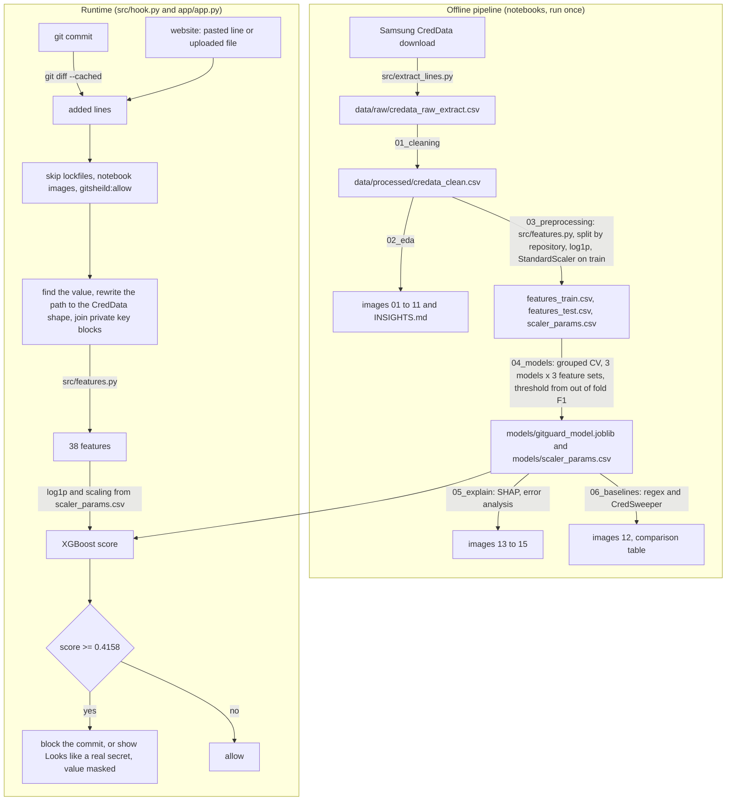

# Architecture

GitShield has two halves. An offline pipeline turns Samsung CredData into a trained model, and a runtime uses that model in two front ends: a pre-commit hook that blocks commits, and a website. Both front ends share one code path, so they always give the same score for the same line.

## Overview

## Components

| Component | File | Role |
| --- | --- | --- |
| Extractor | `src/extract_lines.py` | Reads a CredData download and writes one row per labeled line, finding files by repository and FileID |
| Cleaning | `notebooks/01_cleaning.ipynb` | Drops 1,605 unreliable rows and writes the cleaned file of 66,291 rows |
| Features | `src/features.py` | Turns a row into 39 numeric features (value shape, line, variable name, path, file type). The same function is used in training, in the hook and on the website |
| Preprocessing | `notebooks/03_preprocessing.ipynb` | Splits by repository (268 train, 67 test), applies log1p and a scaler fitted on train only |
| Modelling | `notebooks/04_models.ipynb` | Trains logistic regression, random forest and XGBoost with class weights, tunes them with GroupKFold by repository, picks the threshold from out of fold scores, scores the test set once and saves the hook model |
| Explanation | `notebooks/05_explain.ipynb` | SHAP on all test rows, errors by GroundTruth, file type, path and repository, and comparison with the baselines |
| Baselines | `notebooks/06_baselines.ipynb` | Regex scanner and CredSweeper on the same test lines, and the hook's own value rule on the test lines |
| Model file | `models/gitguard_model.joblib` | One joblib dictionary: `model` (XGBoost), `features` (38 column names in order), `threshold` (0.41578322649002075) and `name` |
| Scaler | `models/scaler_params.csv` | Mean, scale and log1p flag of the 11 numeric features, fitted on the train repositories |
| Hook | `src/hook.py` | Pre-commit hook: reads staged added lines, scores them and blocks the commit when any line is at or above the threshold |
| Website | `app/app.py` | Streamlit front end over the hook's functions, with SHAP reasons for a single line and a file scanner |

## Runtime steps in detail

1. **Collect lines.** The hook reads `git diff --cached --unified=0 --diff-filter=ACM` and keeps only added lines with their file path and line number. The website takes a pasted line with a path, or every line of an uploaded file.
2. **Skip known noise.** Lockfiles (`package-lock.json`, `poetry.lock` and others), notebook image lines and any line containing `gitsheild:allow` are not scanned.
3. **Rebuild the training shape.** The value is the text after the first `:=`, `=>`, `=` or `:`, trimmed and cut at its closing quote. The path is rewritten to `data/00000000/<folders>/00000000.<ext>`, because CredData kept folders but renamed files. A private key is joined from its BEGIN line to its END line into one row, as the labels do.
4. **Build features.** `build_features` from `src/features.py` computes the same columns as in training.
5. **Scale.** log1p and the train scaler from `models/scaler_params.csv` are applied to the 11 numeric features, then the columns are put in the order stored in the model file.
6. **Score and decide.** XGBoost gives a probability. A line at or above 0.4158 is reported. The hook prints the file, line, score and the first four characters of the value followed by stars, and exits with code 1 so git stops the commit. The website shows the same verdict and the six SHAP contributions that pushed the score most.

## Design choices that matter for security

- **The same code in training and at runtime.** The hook and the website call `src/features.py` and the saved scaler, so a model trained on one feature definition is never fed another. 06_baselines checked that the hook's pipeline reproduces the notebook's test F1 of 0.8912 exactly on annotated values.
- **No secret values are stored or printed.** Outputs show four characters and stars. Notebooks print only ids, counts and scores, because GitHub push protection rejects CredData's look alike secrets.
- **Everything runs locally.** The hook makes no network calls. The model and scaler are small files in the repository (about 1 MB), so the hook works offline.
- **Evaluation without leaks.** Train and test repositories never overlap, the scaler is fitted on train only, and every setting and the threshold were chosen before the test set was read.

Detailed results, attacks tried against the hook and lessons are in `docs/SECURITY_ANALYSIS.md`.
